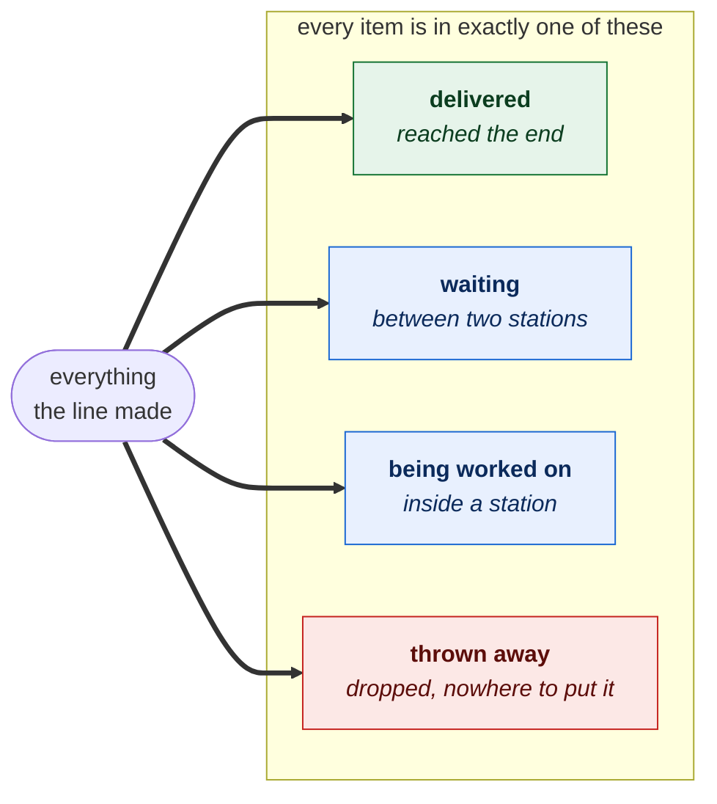
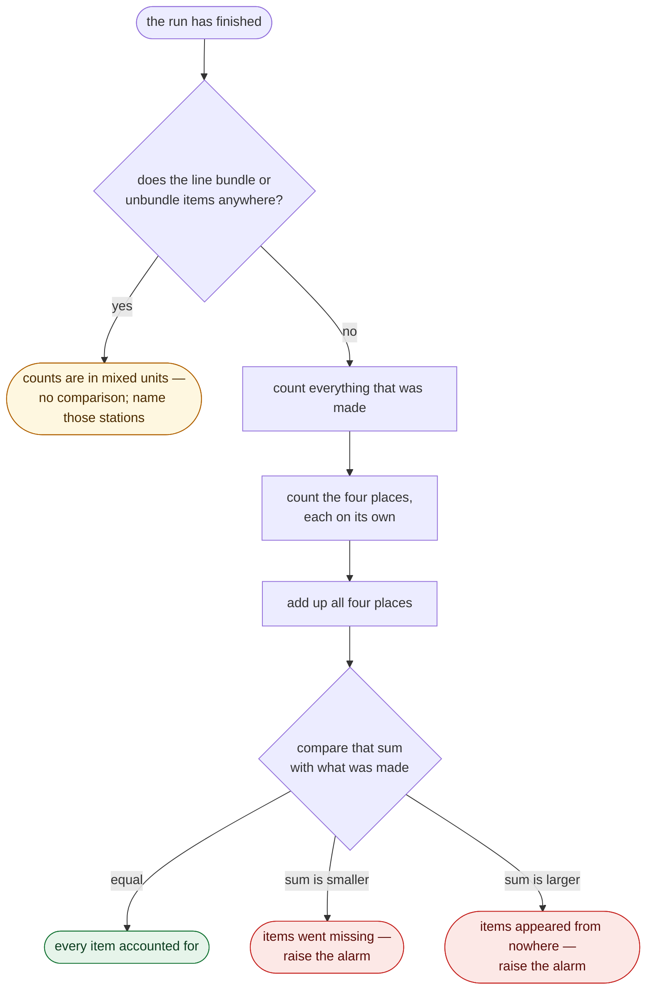

# Conservation check — nothing gets lost

Everything the line makes has to end up somewhere. When the run stops, every
item that was ever made sits in exactly one of four places:

Nothing else can happen to an item. So the amount that was made must equal the
amount spread across those four places:

> **made  =  delivered  +  waiting  +  being worked on  +  thrown away**

If the two sides match, every item is accounted for. If they don't, items went
missing or appeared from nowhere — and that is the alarm to raise. The check also
reports the four numbers themselves and says what they show: what was thrown
away, and how much never left the line.

## The check, in full

Each of the four places is counted on its own, not derived from the others:

- **delivered** is counted by the sinks,
- **waiting** is the level of every buffer, conveyor and fleet,
- **thrown away** is counted by every node that drops an item,
- **being worked on** is counted directly from the nodes: each machine keeps a
  list of the items it is currently working on or waiting to hand over, and a
  source holds the one item it generated but could not hand over yet.

## Why counting the fourth place matters

Made-up items and missing items are **not** equally easy to catch, and how the
fourth place is obtained decides it.

If **being worked on** were taken as "whatever is left over" — made, minus the
three we can see — the two sides would match by construction. A genuinely lost
item would quietly be folded into that leftover and look like normal work still
on the bench. The books would balance only because the missing item was
reclassified rather than found, and a pass would mean *consistent*, not *nothing
was lost*.

Counting it directly removes that escape. An item that vanishes is then in none
of the four places, and the gap between the two sides is exactly the number lost.
The check was compared against the leftover on 140 runs of lines with several
workers per machine, conveyors, fleets, all three selection rules and blocking
and non-blocking nodes, and the two agreed every time. Removing items from a
buffer unseen made them differ by exactly the number removed.

A model built through the tools cannot produce such a gap, because every node
counts what it drops. A non-zero gap therefore points at a fault in the simulation
itself, not at the model. What a model *can* show is the split: items dropped at a
non-blocking node, and how much of the output never left the line. The check
reports both as findings and leaves the judgement to whoever knows how the line
was meant to work.

## When a simple head-count isn't enough

The whole check assumes one item in means one item out at every station. Most
stations honour that. But some deliberately change how many items there are:

- a **bundling** station takes several items and combines them into a single one,
- an **unbundling** station takes one item and separates it back into several.

Where that happens, a plain head-count can't be reconciled: the very same goods
are counted as one number before the station and a different number after it.
Rather than guess, the check reports no comparison for such lines and names the
stations responsible, so a reader knows that counts taken before and after them
are not comparable.

---

*The concept behind the `verify_conservation` check in
`src/simtrace/tools/validation/conservation.py`.*
