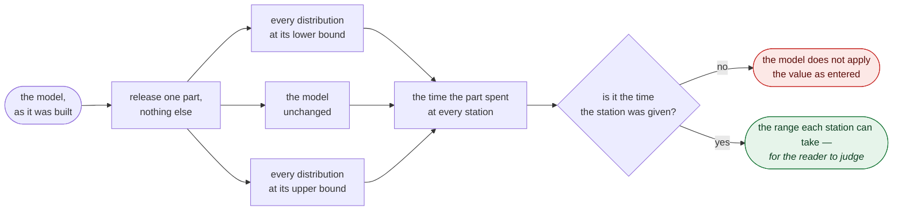

# Grenzwerttest — does a part get the time it was given?

Every number a run reports is an average over hundreds of parts that spent most
of their time waiting. A shift makes 89 shafts; with one wrong parameter it
makes 88, or 92, or 112. None of those is suspicious on its own, and the checks
that exist cannot help here: the wiring is sound, the items add up, and every
delivered part travelled a route the plant really has.

So this check takes the waiting away.

## One part

A copy of the model is built from the build log for each source, and that
source is set to release a single item at time 0 and nothing after it. The
other sources release nothing. One part cannot queue behind another, cannot
block anything and cannot be blocked, so the time it spends at a station is
that station's own time and nothing else.

Each source gets its own copy because two parts released at time 0 can meet.
On the housing line both sources feed the CNC machine, and with both parts in
one copy the cast iron housing waits 3 minutes in a rack that has no holding
time. A combiner is the exception: it needs parts from several sources at once,
so in a model with a combiner every source releases into the same copy.

That is the measurement the whole check rests on. It is read out of the run's
events — when the part was put somewhere, when it was taken away again — not
out of the parameters.

## Three settings

The same part goes through three copies of the model:

| written | lower bound | upper bound |
|---|---|---|
| `uniform(a, b)` | a | b |
| `normal(m, s)`, `gauss(m, s)` | m − 3s, floored at 0 | m + 3s |
| `exp(x)` | 0 | x · ln(1/(1 − quantile)) |
| a constant | itself | itself |

`exp` is the one that has no upper bound. The 99 % quantile stands in for one,
and the report says so rather than passing it off as a limit.

Nothing else is changed. Inter-arrival times are left as they are — the parts
are released by patching the sources, so the arrival parameter itself stays
visible in the table.

## What the check answers by itself

Three things need no knowledge of the plant:

- **A station takes a time it was not given.** The clearest case is a
  processing time entered as a setup time: the machine then reports 0 minutes
  and the part waits 4 minutes in the buffer in front of it, which has no
  holding time at all. Both halves of that are in the table, and the mismatch
  is reported.
- **A part beats the floor.** The single part at the lower bound takes the
  shortest time the plant allows; waiting only adds to it. A part in a real run
  that is quicker than that did not visit every station. Its route is printed,
  which names the branch that skips one.
- **A time that can fall to zero, or has no upper bound.** Both are worth a
  second look, and both are properties of the value alone.

## What the reader answers

The rest is a table of ranges, and the judgement is the reader's:

    Haertekorb A   normal(20, 3)   11.00  22.54  29.00
    Haertekorb A   exp(20)          0.00   3.27  92.10
    Haertekorb A   normal(20, 6)    2.00  25.08  38.00
    Drehen         uniform(4, 16)   4.00   7.89  16.00

Every one of those four lines comes from a model that runs cleanly and makes a
normal number of shafts per shift. Anyone who knows that hardening takes about
twenty minutes sees the second and third line immediately, and the fourth if
they know that turning takes four to six. That is the Sargent idea: the
expected result comes from knowing the real plant, and the model is held
against it.

## Every combination

Sargent asks that the model stay plausible for any extreme combination of
factor levels, and the three settings above cover only two of those: every
station low, every station high. So each station whose time is a distribution
is also set to its lower or upper bound on its own, in every combination, and
the model runs once per combination with its sources as entered. Sources and
sinks are not varied.

Each combination runs five times, with seeds 0, 1000, 2000, 3000 and 4000
added to the seed, the same five in every combination. One run would not do. At
a bound every station time is a fixed number, but the arrivals, the breakdowns,
the repairs and the route shares still draw, and they all draw from one random
stream. A combination that changes a station's time changes the order of the
draws, so the source gets other arrival times. On the correct gear-shaft line
with seed 1, one run per combination had mill 2 deliver 770 parts at its upper
bound and 741 at its lower bound. With the breakdowns taken out, the same line
showed nothing.

So a station's effect is taken per seed: parts delivered at its lower bound
minus at its upper bound, every other station unchanged. A station is reported
when the mean of its effects over the five seeds stays below zero at its
one-sided 95 % bound, with the 5 % shared out over the stations (Bonferroni),
or when one combination's mean does, with the 5 % shared out over every pair.
With one run per combination, `replications=1`, every negative effect is
reported, as before.

Six stations give 2⁶ = 64 combinations and 320 runs, about 20 seconds for the
gear-shaft line on several cores. Each further station doubles the count. Past
256 combinations, only the two corners and each station set against all the
others are run, 2 · k + 2 combinations for k stations.

A separate random stream for each component would make the arrivals and
breakdowns the same in every combination (common random numbers) and would
need fewer runs. It is not built.

What the combinations report:

- **A longer time delivers more parts.** A station at its upper bound, every
  other station unchanged, delivers more than at its lower bound, by more than
  the spread over the five seeds. A longer time
  cannot add output, so the model is wrong somewhere, in the wiring or in a
  field that holds the wrong value.
- **A combination raises, delivers nothing, or loses items.** The same checks
  as for a single run, applied to every combination.
- **A station changes nothing.** In no combination does moving it between its
  bounds change the count by more than one part, on average over the seeds.
  This is a hint, not a fault: the station never
  limits the line. The hint needs a line with little noise. On the pallet line
  with a pallet every 16 minutes, all three stations get it. On the gear-shaft
  line with the turning time entered ten times too short, turning falls from
  the top of the influence list (123 parts) to the bottom (−2.3 ± 13.1), but
  the breakdowns keep its effect too noisy for the hint.

Next to the findings, every station gets its influence: parts delivered at its
lower bound minus at its upper bound, as mean, smallest and largest over the
combinations. The station at the top is the one that limits the line.

## Extreme inputs

The combinations move the station times only between the bounds of their own
distributions. The classic extreme-condition test (Forrester and Senge 1980,
Barlas 1996) changes the inputs instead, far past anything the plant sees, and
writes down before the run what a real plant would do. A test without a stated
expectation cannot fail. So each case has one:

| case | what changes | what a real plant would do |
|---|---|---|
| `no_arrivals` | no source releases anything | 0 items created, 0 parts delivered |
| `arrivals_x10` | every inter-arrival time divided by 10, all arguments of a distribution alike | the output does not fall below the model as built |
| `endless_buffers` | every buffer holds 1,000,000 items | no station whose out-edges are all buffers is blocked |

These expectations are large and qualitative: a direction, a fixed value or a
limit, not a number close to another. So `no_arrivals` and `endless_buffers`
run once. `arrivals_x10` is the exception on a line that already runs at its
limit. The gear-shaft line makes 868 parts on average as built and 852 with
ten times the arrivals, over the same five seeds. The difference is noise from
the breakdowns, so this case runs once per seed next to the model as built and
is reported only when the mean difference stays below 0 at its one-sided 95 %
bound.

A station blocked behind a conveyor or a fleet is left out of
`endless_buffers`, since only the buffers are made endless.

## Targeted extremes

Rabe, Spieckermann and Wenzel describe the Grenzwerttest as setting inputs and
parameters so that the model's behaviour becomes predictable, not as sweeping
every minimum and maximum. Three such settings push one thing in the model
past its bounds, one run each:

| case | what changes | what a real plant would do |
|---|---|---|
| `station_stopped` | one station never finishes a part, in turn for every station | a part reaches a sink only on a route that leaves this station out |
| `one_branch` | a station with route shares sends every part down one branch, in turn for every branch | the parts end in the sink this branch leads to, counted the way that sink counts them |
| `one_source` | only one source releases parts, in turn for every source, when there are two or more | only the stations on that source's route work |

Unlike the extreme inputs, the outcome here depends on the plant. Whether a
stopped mill must stop the line or the other mill takes its work is written in
the specification, not in the model. So these runs pass no verdict. Each one
reports the parts per sink, how the per-type report counted them, which
stations worked, and the routes the delivered parts took. A run that raises or
loses items is still an error.

Four faults that every other check here misses, held against the correct
lines at seed 1:

| fault in the build | normal run, correct / faulty | targeted extreme, correct / faulty |
|---|---|---|
| the lathe feeds the mills first-free instead of in turn | 881 / 877 shafts | mill 1 stopped: 6 / 507 shafts |
| 1 in 10 cast iron housings goes from blasting to shipping | 84 / 91 housings | leak test stopped: 0 / 1 shipped, via blast → ship |
| the scrap bin is built without the scrap flag | 4 / 0 scrapped | every part to the scrap branch: 104 / 0 scrapped |
| the CNC routes are swapped between the materials | 84 / 92 housings | aluminium alone: deburring works / blasting works |

With the leak test stopped the line jams soon, so only one housing gets
through. Its route still names the branch that skips the test.

## The report page

With `report_path` the check also writes one HTML page: the findings, the
station table, and a chart for each figure (station times for one part, station
times in the run, part totals against the floor, influence, parts per
combination, time shares). The charts are inline SVG, so the page opens offline
and stays small, about 30 KB for seven stations. The MCP tool writes it to
`out/extreme_conditions.html` under the server's working directory by default
and returns the absolute path.

## What it will not answer

A mean that is off by a little moves both bounds with it. `normal(23, 3)`
instead of `normal(20, 3)` gives 14 to 32 instead of 11 to 29, and nothing in
the table looks wrong. This check does not find that, and neither does any
other check in this project — the run makes 88 shafts either way.

Two further limits:

- A single part takes one branch through a fan-out, so the stations on the
  other branch are marked as not visited. Their times come from the run's parts
  instead, where the waiting is included.
- A combiner needs several items per cycle. With one part per source it never
  completes, and the check reports that the part is stuck rather than guessing.
  `parts_per_source` raises the count, and then the times include waiting.

## Where it sits

Run it after the wiring check and after a normal run: with a finished run in
the model it also measures that run's parts, station by station, against the
same single part. It builds its own copies, so it neither needs the session
model's clock nor disturbs it.
