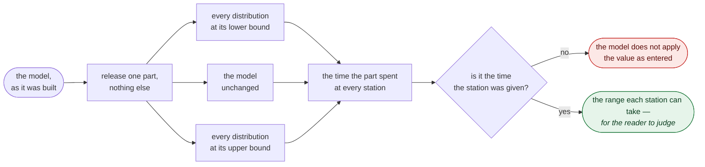

# Grenzwerttest — does a part get the time it was given?

Every number a run reports is an average over hundreds of parts that spent most
of their time waiting. A shift makes 89 shafts; with one wrong parameter it
makes 88, or 92, or 112. None of those is suspicious on its own, and the checks
that exist cannot help here: the wiring is sound, the items add up, and every
delivered part travelled a route the plant really has.

So this check takes the waiting away.

## One part

A copy of the model is built from the build log and every source is set to
release a single item at time 0 and nothing after it. One part cannot queue
behind another, cannot block anything and cannot be blocked, so the time it
spends at a station is that station's own time and nothing else.

That is the measurement the whole check rests on. It is read out of the run's
events — when the part was put somewhere, when it was taken away again — not
out of the parameters.

## Three settings

The same part goes through three copies of the model:

| written | lower bound | upper bound |
|---|---|---|
| `uniform(a, b)` | a | b |
| `normal(m, s)`, `gauss(m, s)` | m − 3s, floored at 0 | m + 3s |
| `exp(x)` | 0 | x · ln(1/(1 − quantile)) |
| a constant | itself | itself |

`exp` is the one that has no upper bound. The 99 % quantile stands in for one,
and the report says so rather than passing it off as a limit.

Nothing else is changed. Inter-arrival times are left as they are — the parts
are released by patching the sources, so the arrival parameter itself stays
visible in the table.

## What the check answers by itself

Three things need no knowledge of the plant:

- **A station takes a time it was not given.** The clearest case is a
  processing time entered as a setup time: the machine then reports 0 minutes
  and the part waits 4 minutes in the buffer in front of it, which has no
  holding time at all. Both halves of that are in the table, and the mismatch
  is reported.
- **A part beats the floor.** The single part at the lower bound takes the
  shortest time the plant allows; waiting only adds to it. A part in a real run
  that is quicker than that did not visit every station. Its route is printed,
  which names the branch that skips one.
- **A time that can fall to zero, or has no upper bound.** Both are worth a
  second look, and both are properties of the value alone.

## What the reader answers

The rest is a table of ranges, and the judgement is the reader's:

    Haertekorb A   normal(20, 3)   11.00  22.54  29.00
    Haertekorb A   exp(20)          0.00   3.27  92.10
    Haertekorb A   normal(20, 6)    2.00  25.08  38.00
    Drehen         uniform(4, 16)   4.00   7.89  16.00

Every one of those four lines comes from a model that runs cleanly and makes a
normal number of shafts per shift. Anyone who knows that hardening takes about
twenty minutes sees the second and third line immediately, and the fourth if
they know that turning takes four to six. That is the Sargent idea: the
expected result comes from knowing the real plant, and the model is held
against it.

## What it will not answer

A mean that is off by a little moves both bounds with it. `normal(23, 3)`
instead of `normal(20, 3)` gives 14 to 32 instead of 11 to 29, and nothing in
the table looks wrong. This check does not find that, and neither does any
other check in this project — the run makes 88 shafts either way.

Two further limits:

- A single part takes one branch through a fan-out, so the stations on the
  other branch are marked as not visited. Their times come from the run's parts
  instead, where the waiting is included.
- A combiner needs several items per cycle. With one part per source it never
  completes, and the check reports that the part is stuck rather than guessing.
  `parts_per_source` raises the count, and then the times include waiting.

## Where it sits

Run it after the wiring check and after a normal run: with a finished run in
the model it also measures that run's parts, station by station, against the
same single part. It builds its own copies, so it neither needs the session
model's clock nor disturbs it.
