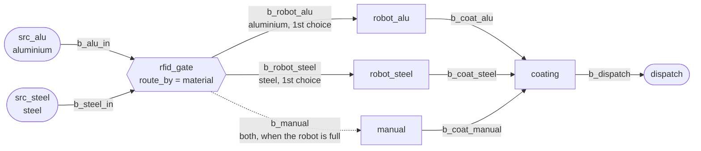

# Example: bike frames sorted by material and free welding cell

## Plain words

> We weld bicycle frames in two materials. Aluminium frames arrive about
> every 10 minutes, steel frames about every 12 minutes, both irregularly.
> Every frame sits in a jig with an RFID tag. Each material waits on its own
> infeed rack in front of an RFID gate. The gate reads the tag, which takes
> 0.1 minutes. A diverter then sends the frame to a welding place. We have
> three. One welding robot only welds aluminium and needs 11 to 13 minutes
> per frame. A second robot only welds steel and needs 13 to 15 minutes. A
> manual welding bench can weld both materials but needs 18 to 24 minutes.
> In front of each welding place there is room for one frame. The diverter
> sends a frame to the robot for its own material when there is room there,
> otherwise to the manual bench. If both are full, the frame waits at the
> gate until one of them has room. Each welding place puts its welded
> frames on its own rack in front of the powder coating station. Coating
> takes 3 minutes per frame, one frame at a time. Coated frames go onto one
> rack before dispatch. All other racks hold 8 frames, and a station waits
> when the next rack is full. An aluminium frame sells
> for 140 €, a steel frame for 95 €. Simulate one 8-hour shift (480 minutes)
> and tell me how many frames of each material we dispatch, what they are
> worth and how many frames each welding place welded.

## Technical definition

All times in minutes. Every buffer: `delay=0`. The three buffers in front of
the welding places have `capacity=1`, all others `capacity=8`.

| Node          | Type    | Settings |
|---------------|---------|----------|
| `src_alu`     | Source  | `inter_arrival_time="exp(10)"`, `blocking=True`, `part_type="aluminium_frame"`, `attributes={"material": "aluminium", "price": 140}` |
| `src_steel`   | Source  | `inter_arrival_time="exp(12)"`, `blocking=True`, `part_type="steel_frame"`, `attributes={"material": "steel", "price": 95}` |
| `rfid_gate`   | Machine | `processing_delay=0.1`, `route_by="material"`, `routes={"aluminium": ["b_robot_alu", "b_manual"], "steel": ["b_robot_steel", "b_manual"]}` |
| `robot_alu`   | Machine | `processing_delay="uniform(11, 13)"` |
| `robot_steel` | Machine | `processing_delay="uniform(13, 15)"` |
| `manual`      | Machine | `processing_delay="uniform(18, 24)"` |
| `coating`     | Machine | `processing_delay=3` |
| `dispatch`    | Sink    | |

Edges, in connect order:

| Edge            | From          | To            |
|-----------------|---------------|---------------|
| `b_alu_in`      | `src_alu`     | `rfid_gate`   |
| `b_steel_in`    | `src_steel`   | `rfid_gate`   |
| `b_robot_alu`   | `rfid_gate`   | `robot_alu`   |
| `b_robot_steel` | `rfid_gate`   | `robot_steel` |
| `b_manual`      | `rfid_gate`   | `manual`      |
| `b_coat_alu`    | `robot_alu`   | `coating`     |
| `b_coat_steel`  | `robot_steel` | `coating`     |
| `b_coat_manual` | `manual`      | `coating`     |
| `b_dispatch`    | `coating`     | `dispatch`    |

Run: `run_simulation(until=480)`.

## Trail

