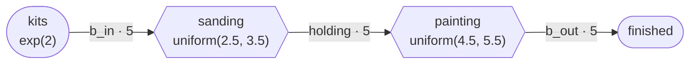

# Example: chair workshop

## Plain words

We make wooden chairs. Raw chair kits arrive on average every 2 minutes,
exponentially distributed. Each kit is first sanded, which takes 2.5 to 3.5
minutes, uniformly distributed. Then it is painted, which takes 4.5 to 5.5
minutes, uniformly distributed. Each station works on one kit at a time.
There is a rack for 5 kits before sanding and a holding area for 5 kits
between sanding and painting. Painted chairs go onto a rack for 5 chairs and
then leave the shop. When the rack before sanding is full, the next kit waits
until a place is free. No kit is lost. Every station waits when the place after
it is full. Simulate one 8-hour shift, 480 minutes, starting empty.

## Technical definition

All times in minutes. Every buffer: `delay=0`, `capacity=5`.

| Node       | Type    | Settings |
|------------|---------|----------|
| `kits`     | Source  | `inter_arrival_time="exp(2)"`, `blocking=True` |
| `sanding`  | Machine | `processing_delay="uniform(2.5, 3.5)"` |
| `painting` | Machine | `processing_delay="uniform(4.5, 5.5)"` |
| `finished` | Sink    | |

| Edge      | From       | To         |
|-----------|------------|------------|
| `b_in`    | `kits`     | `sanding`  |
| `holding` | `sanding`  | `painting` |
| `b_out`   | `painting` | `finished` |

Run: `run_replications(until=480, ...)`.

## What to watch for

- **Every link needs an edge** — a node can only be wired through an edge, so
  the model needs a buffer on each link (kits → sanding, sanding → painting,
  painting → finished), not just the one holding area.
- **Units and horizon** — everything in minutes, run until 480.
- **The bottleneck** — painting at 4.5 to 5.5 minutes per kit is slower than
  both the arrivals and sanding, so painting limits the line, the holding area
  fills, and sanding is blocked part of the time.

## Trail

