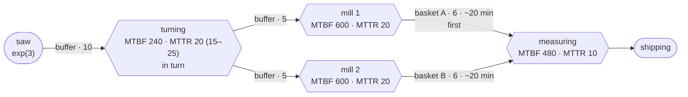

# Example: gear shaft line with breakdowns

## Plain words

Blanks arrive on average every 3 minutes, exponentially distributed. A lathe
turns each blank in 4 to 6 minutes, uniformly distributed, and hands the
shafts in turn to two mills. Milling takes on average 8 minutes, normally
distributed with a standard deviation of 1 minute. Behind each mill the shafts
lie in a hardening basket for 6 shafts, on average 20 minutes, normally
distributed with a standard deviation of 3 minutes. One measuring machine
takes them from both baskets, the one behind mill 1 first, and needs 2 to 3
minutes per shaft, uniformly distributed. Then they are shipped. There are 10
places before turning and 5 before each mill, and a station waits when the
buffer after it is full. The lathe has an MTBF of 240 minutes
and an MTTR of 20 minutes, with repairs between 15 and 25 minutes. Each mill
has an MTBF of 600 and an MTTR of 20 minutes, measuring an MTBF of 480 and an
MTTR of 10 minutes. MTBF counts from one failure to the next. Simulate one week,
2400 minutes, starting empty.

## Question

How many shafts reach shipping in one week? How often does each machine fail,
and how long is it down in total? Whose breakdowns cost the most shafts?

## Technical definition

All times in minutes. Every buffer without a stated delay has `delay=0`.

| Node      | Type    | Settings |
|-----------|---------|----------|
| `saege`   | Source  | `inter_arrival_time="exp(3)"`, `blocking=True` |
| `drehen`  | Machine | `processing_delay="uniform(4, 6)"`, `out_edge_selection="ROUND_ROBIN"`, `time_to_failure="exp(220)"`, `repair_time="uniform(15, 25)"` |
| `fraese1` | Machine | `processing_delay="normal(8, 1)"`, `time_to_failure="exp(580)"`, `repair_time="exp(20)"` |
| `fraese2` | Machine | `processing_delay="normal(8, 1)"`, `time_to_failure="exp(580)"`, `repair_time="exp(20)"` |
| `messen`  | Machine | `processing_delay="uniform(2, 3)"`, `time_to_failure="exp(470)"`, `repair_time="exp(10)"` |
| `versand` | Sink    | |

MTBF includes the repair, so `time_to_failure` is MTBF − MTTR at every
station:

| Station   | MTBF | MTTR | `time_to_failure` |
|-----------|------|------|-------------------|
| `drehen`  | 240  | 20   | 220 |
| `fraese1` | 600  | 20   | 580 |
| `fraese2` | 600  | 20   | 580 |
| `messen`  | 480  | 10   | 470 |

| Edge               | From      | To        | Settings |
|--------------------|-----------|-----------|----------|
| `b_saege_drehen`   | `saege`   | `drehen`  | `capacity=10` |
| `b_drehen_f1`      | `drehen`  | `fraese1` | `capacity=5` |
| `b_drehen_f2`      | `drehen`  | `fraese2` | `capacity=5` |
| `korb_a`           | `fraese1` | `messen`  | `capacity=6`, `delay="normal(20, 3)"` |
| `korb_b`           | `fraese2` | `messen`  | `capacity=6`, `delay="normal(20, 3)"` |
| `b_messen_versand` | `messen`  | `versand` | `capacity=1` |

## Trail

