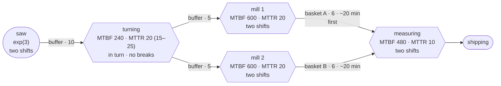

# Example: gear shaft line with shifts and breakdowns

## Plain words

Blanks arrive on average every 3 minutes, exponentially distributed. A lathe
turns each blank in 4 to 6 minutes, uniformly distributed, and hands the
shafts in turn to two mills. Milling takes on average 8 minutes, normally
distributed with a standard deviation of 1 minute. Behind each mill the shafts
lie in a hardening basket for 6 shafts, on average 20 minutes, normally
distributed with a standard deviation of 3 minutes. One measuring machine
takes them from both baskets, the one behind mill 1 first, and needs 2 to 3
minutes per shaft, uniformly distributed. Then they are shipped. There are 10
places before turning and 5 before each mill, and a station waits when the
buffer after it is full. When all 10 places before turning are full, the next
blank waits until a place is free. No blank is lost. The lathe has an MTBF of
240 minutes and an MTTR of 20 minutes, with repairs between 15 and 25 minutes,
uniformly distributed. Each mill has an MTBF of 600 and an MTTR of 20 minutes,
measuring an MTBF of 480 and an MTTR of 10 minutes. MTBF counts from one
failure to the next. The times between failures and the repairs at the mills
and at measuring are exponentially distributed. The plant works in two
shifts, from 6:00 to 14:00 and from 14:00 to 22:00, with no night work. There
is a 15-minute break at 9:00 and at 17:00 and a 30-minute break at 12:00 and
at 20:00. In the breaks and at night no blanks arrive and every station stops.
The lathe is the only exception in the breaks. A relief worker keeps it
running, so the lathe works from 6:00 to 22:00 without a break and stops at
night like the rest.
A job that is not finished when work stops is finished when work starts
again. The shafts in the hardening baskets keep hardening at night. Breakdowns
and repairs count working time only. Simulate Monday to Friday, 7200 minutes,
starting empty at midnight on Monday.

## Question

How many shafts reach shipping from Monday to Friday? How much time is each
station off? How many more shafts do we ship because of the relief worker at
the lathe?

## Technical definition

All times in minutes. Every buffer without a stated delay has `delay=0`.

| Calendar          | Settings |
|-------------------|----------|
| `two_shifts`      | `cycle=1440`, `windows=[[360, 540], [555, 720], [750, 1020], [1035, 1200], [1230, 1320]]`, `default=True` |
| `lathe_no_breaks` | `cycle=1440`, `windows=[[360, 1320]]` |

Time 0 is midnight on Monday. The shift change at 14:00 (840) lies inside the
window from 12:30 to 17:00, because work goes on without a gap.

| Node      | Type    | Settings |
|-----------|---------|----------|
| `saege`   | Source  | `inter_arrival_time="exp(3)"`, `blocking=True` |
| `drehen`  | Machine | `processing_delay="uniform(4, 6)"`, `out_edge_selection="ROUND_ROBIN"`, `time_to_failure="exp(220)"`, `repair_time="uniform(15, 25)"`, `calendar="lathe_no_breaks"` |
| `fraese1` | Machine | `processing_delay="normal(8, 1)"`, `time_to_failure="exp(580)"`, `repair_time="exp(20)"` |
| `fraese2` | Machine | `processing_delay="normal(8, 1)"`, `time_to_failure="exp(580)"`, `repair_time="exp(20)"` |
| `messen`  | Machine | `processing_delay="uniform(2, 3)"`, `time_to_failure="exp(470)"`, `repair_time="exp(10)"` |
| `versand` | Sink    | |

Every node without a `calendar` follows `two_shifts`.

MTBF includes the repair, so `time_to_failure` is MTBF − MTTR at every
station:

| Station   | MTBF | MTTR | `time_to_failure` |
|-----------|------|------|-------------------|
| `drehen`  | 240  | 20   | 220 |
| `fraese1` | 600  | 20   | 580 |
| `fraese2` | 600  | 20   | 580 |
| `messen`  | 480  | 10   | 470 |

| Edge               | From      | To        | Settings |
|--------------------|-----------|-----------|----------|
| `b_saege_drehen`   | `saege`   | `drehen`  | `capacity=10` |
| `b_drehen_f1`      | `drehen`  | `fraese1` | `capacity=5` |
| `b_drehen_f2`      | `drehen`  | `fraese2` | `capacity=5` |
| `korb_a`           | `fraese1` | `messen`  | `capacity=6`, `delay="normal(20, 3)"` |
| `korb_b`           | `fraese2` | `messen`  | `capacity=6`, `delay="normal(20, 3)"` |
| `b_messen_versand` | `messen`  | `versand` | `capacity=1` |

Run: `run_replications(until=7200, ...)`. For the relief worker, a second
model without `calendar="lathe_no_breaks"` on `drehen`, run the same way.

## Trail

