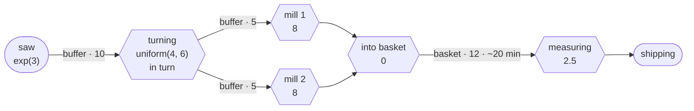

# Example: gear shaft line

## Plain words

Blanks arrive from the saw on average every 3 minutes, exponentially
distributed. A lathe turns each blank in 4 to 6 minutes, uniformly
distributed, and hands the shafts in turn to two mills. Each mill works on one
shaft at a time and needs 8 minutes per shaft. Both mills put their shafts
into one shared hardening basket for 12 shafts. Nobody works on them there.
They lie in the basket on average 20 minutes, normally distributed with a
standard deviation of 3 minutes. If both mills finish at the same time, the
shaft from mill 1 goes into the basket first. One measuring machine takes the
shafts from the basket and needs 2.5 minutes per shaft. Then they are shipped.
There are 10 places before turning and 5 before each mill. When all 10 places
before turning are full, the next blank waits until a place is free. No blank
is lost. Every station waits when the place after it is full. Simulate one
8-hour shift, 480 minutes, starting empty.

## Question

How many shafts reach shipping in one shift? Which station limits the line?
How evenly are the two mills used? Does the hardening basket fill up?

## Technical definition

All times in minutes. Every buffer without a stated delay has `delay=0`.

| Node      | Type    | Settings |
|-----------|---------|----------|
| `saege`   | Source  | `inter_arrival_time="exp(3)"`, `blocking=True` |
| `drehen`  | Machine | `processing_delay="uniform(4, 6)"`, `out_edge_selection="ROUND_ROBIN"` |
| `fraese1` | Machine | `processing_delay=8` |
| `fraese2` | Machine | `processing_delay=8` |
| `einlegen`| Machine | `processing_delay=0` |
| `messen`  | Machine | `processing_delay=2.5` |
| `versand` | Sink    | |

An edge connects one node to one node. `einlegen` joins the two mill streams
in front of the one basket and takes no time. It drains `b_f1_einlegen` first.

| Edge               | From       | To         | Settings |
|--------------------|------------|------------|----------|
| `b_saege_drehen`   | `saege`    | `drehen`   | `capacity=10` |
| `b_drehen_f1`      | `drehen`   | `fraese1`  | `capacity=5` |
| `b_drehen_f2`      | `drehen`   | `fraese2`  | `capacity=5` |
| `b_f1_einlegen`    | `fraese1`  | `einlegen` | `capacity=1` |
| `b_f2_einlegen`    | `fraese2`  | `einlegen` | `capacity=1` |
| `korb`             | `einlegen` | `messen`   | `capacity=12`, `delay="normal(20, 3)"` |
| `b_messen_versand` | `messen`   | `versand`  | `capacity=1` |

Connect `b_f1_einlegen` before `b_f2_einlegen`.

Run: `run_replications(until=480, ...)`.

## Trail

