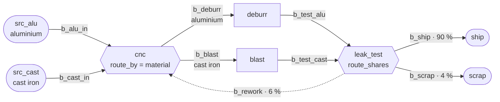

# Example: gearbox housing line

## Plain words

> We machine gearbox housings in two materials. Aluminium housings arrive
> about every 8 minutes, cast iron housings about every 12 minutes, both
> irregularly. Every housing is first machined on our one CNC machine, which
> takes 3 to 4 minutes. After that, aluminium housings go to the deburring
> bench (2 minutes each), and cast iron housings go to the shot blaster
> (2.5 to 3.5 minutes each). Then every housing gets a leak test, 1.5 minutes
> each. 90 out of 100 housings pass and are shipped. 6 out of 100 go back to
> the CNC machine to be machined again, and are taken first there. 4 out of
> 100 are scrapped. Every rack between two stations holds 10 housings, and a
> station waits when the next rack is full. An aluminium housing sells for
> 85 €, a cast iron housing for 60 €. Simulate one 8-hour shift (480 minutes)
> and tell me how many housings of each material we ship, how many we scrap
> and what the shipped housings are worth.

## Technical definition

All times in minutes. Every buffer: `capacity=10`, `delay=0`.

| Node        | Type    | Settings |
|-------------|---------|----------|
| `src_alu`   | Source  | `inter_arrival_time="exp(8)"`, `blocking=True`, `part_type="aluminium_housing"`, `attributes={"material": "aluminium", "price": 85}` |
| `src_cast`  | Source  | `inter_arrival_time="exp(12)"`, `blocking=True`, `part_type="cast_iron_housing"`, `attributes={"material": "cast_iron", "price": 60}` |
| `cnc`       | Machine | `processing_delay="uniform(3, 4)"`, `route_by="material"`, `routes={"aluminium": "b_deburr", "cast_iron": "b_blast"}` |
| `deburr`    | Machine | `processing_delay=2` |
| `blast`     | Machine | `processing_delay="uniform(2.5, 3.5)"` |
| `leak_test` | Machine | `processing_delay=1.5`, `route_shares={"b_ship": 0.9, "b_rework": 0.06, "b_scrap": 0.04}` |
| `ship`      | Sink    | |
| `scrap`     | Sink    | `scrap=True` |

Edges, in connect order (`b_rework` first, so returned housings go first at `cnc`):

| Edge          | From        | To          |
|---------------|-------------|-------------|
| `b_rework`    | `leak_test` | `cnc`       |
| `b_alu_in`    | `src_alu`   | `cnc`       |
| `b_cast_in`   | `src_cast`  | `cnc`       |
| `b_deburr`    | `cnc`       | `deburr`    |
| `b_blast`     | `cnc`       | `blast`     |
| `b_test_alu`  | `deburr`    | `leak_test` |
| `b_test_cast` | `blast`     | `leak_test` |
| `b_ship`      | `leak_test` | `ship`      |
| `b_scrap`     | `leak_test` | `scrap`     |

Run: `run_simulation(until=480)`.

## Trail

